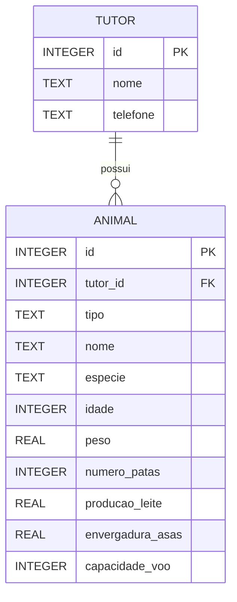

# Sistema de Gerenciamento de Animais

Projeto 2 (P2) da disciplina de Programação Orientada a Objetos com Java e JPA.
Aplicação Java de console que persiste dados em banco relacional (SQLite) com **JDBC puro**, usando **duas entidades ligadas em relacionamento 1:N**.

## 1. Integrantes

- Alice Miranda Martins
- Arthur Souza Ribeiro
- Arthur Yuji Mendes Suzuki
- Felipe Souza de Jesus
- Luiz Miguel Mazzega Lamas

## 2. Tema Escolhido

**Animais sob responsabilidade de tutores** (domínio: gestão de animais de estimação e de criação).
Um tutor pode ser responsável por vários animais; cada animal pertence a um único tutor.

## 3. Descrição do Sistema

O sistema permite cadastrar **tutores** e **animais**, consultar, atualizar e remover ambos pelo menu de console, calcular o consumo alimentar diário de um animal e gerar um relatório geral.

Os animais seguem a hierarquia da parte 1 do projeto:

- `Animal` (classe base abstrata): nome, espécie, idade e peso.
- `Mamifero` (subclasse): número de patas e produção de leite diária.
- `Ave` (subclasse): envergadura das asas e capacidade de voo.

Os dados são gravados em um arquivo de banco SQLite (`animais.db`), criado automaticamente na pasta de execução. Ao reiniciar o programa, os dados continuam disponíveis.

## 4. Modelo de Dados

O sistema modela **2 entidades** relacionadas em **1:N**: um `Tutor` possui vários `Animal`.



**Relacionamento 1:N:** a coluna `animal.tutor_id` é chave estrangeira para `tutor.id` (`NOT NULL`, com `ON DELETE CASCADE`).

**Hierarquia de animais:** `Mamifero` e `Ave` são guardadas na mesma tabela `animal`. A coluna `tipo` (valor do enum `TipoAnimal`: `MAMIFERO` ou `AVE`) indica a subclasse a ser recriada na leitura. Atributos que não se aplicam ao tipo ficam `NULL`.

## 5. Tecnologias Utilizadas

- **Linguagem:** Java 17 ou superior (usa `switch` com `->` e *pattern matching* em `instanceof`).
- **Persistência:** JDBC puro (sem JPA, sem Hibernate).
- **Banco de dados:** SQLite, via driver `sqlite-jdbc` (org.xerial), versão 3.46.0.0 ou qualquer 3.x.
- **IDE:** qualquer uma (IntelliJ IDEA, Eclipse, VS Code) ou linha de comando.
- **JDK:** 17 ou superior.

## 6. Estrutura do Projeto

```
Projeto-animais-em-Orienta--o-a-Objetos-main/
├── README.md
├── SistemaAnimais.java                  Menu CLI e fluxo principal
└── ProjetoAnimais/
    ├── Animal.java                      Classe base abstrata da hierarquia
    ├── Mamifero.java                    Subclasse de Animal
    ├── Ave.java                         Subclasse de Animal
    ├── Tutor.java                       Entidade "1" do relacionamento 1:N
    ├── TipoAnimal.java                  Enumerador dos tipos de animal
    ├── excecao/
    │   ├── PersistenciaException.java           Falhas de acesso ao banco
    │   └── RecursoNaoEncontradoException.java   ID inexistente
    └── repositorio/
        ├── Repositorio.java             Interface genérica de CRUD
        ├── RepositorioTutor.java        Interface para Tutor
        ├── RepositorioAnimal.java       Interface para Animal (inclui consulta por tutor)
        └── jdbc/
            ├── ConexaoSQLite.java       Conexão e criação das tabelas
            ├── TutorRepositorioJdbc.java
            └── AnimalRepositorioJdbc.java
```

Conceitos das aulas aplicados: herança e polimorfismo (aulas anteriores à 7), interfaces e enumeradores (aula 7), `List`, `Map` e `Set` com `ArrayList`, `EnumMap`, `TreeMap`, `TreeSet` e `HashSet` (aula 8), exceções personalizadas com `try-catch` (aula 9), SQL de DDL e DML com chave estrangeira (aula 10), JDBC com `PreparedStatement` e `ResultSet` (aula 11) e mapeamento de relacionamento 1:N pela chave estrangeira `tutor_id` (aulas 12 a 14).

## 7. Como Executar

### 7.1 Baixar o driver do SQLite

O projeto não inclui arquivos `.jar`. Crie uma pasta `lib/` na raiz do projeto e baixe o driver `sqlite-jdbc` (por exemplo, `sqlite-jdbc-3.46.0.0.jar`) do Maven Central para dentro dela.

### 7.2 Compilar e executar pela linha de comando

Linux / macOS (a partir da pasta raiz do projeto):

```bash
mkdir -p out
javac -d out -cp lib/sqlite-jdbc-3.46.0.0.jar $(find . -name "*.java")
java -cp out:lib/sqlite-jdbc-3.46.0.0.jar SistemaAnimais
```

Windows (Prompt de Comando, a partir da pasta raiz do projeto):

```bat
mkdir out
dir /s /b *.java > fontes.txt
javac -d out -cp lib\sqlite-jdbc-3.46.0.0.jar @fontes.txt
java -cp out;lib\sqlite-jdbc-3.46.0.0.jar SistemaAnimais
```

### 7.3 Executar pela IDE

1. Crie um projeto Java e importe os arquivos `.java` mantendo as pastas (`ProjetoAnimais/...`).
2. Adicione `sqlite-jdbc-3.46.0.0.jar` às dependências do projeto (em IntelliJ: *Project Structure → Libraries*; em Eclipse: *Build Path → Add External JARs*).
3. Execute a classe `SistemaAnimais`.

O arquivo `animais.db` é criado automaticamente na pasta de onde o programa é executado. Se o driver não estiver no classpath, o programa exibe uma mensagem explicando o problema e encerra.

## 8. Funcionalidades

| Opção | Funcionalidade | Operação CRUD |
|------:|----------------|---------------|
| 1 | Cadastrar tutor (nome e telefone) | Create |
| 2 | Listar tutores | Read |
| 3 | Atualizar tutor (Enter mantém o valor atual) | Update |
| 4 | Remover tutor (exibe quantos animais serão removidos e pede confirmação) | Delete |
| 5 | Cadastrar animal: escolher o tutor responsável e o tipo (Mamífero ou Ave) | Create |
| 6 | Listar todos os animais, com ID do tutor e tipo | Read |
| 7 | Atualizar animal (Enter mantém o valor atual) | Update |
| 8 | Remover animal (pede confirmação) | Delete |
| 9 | Calcular consumo alimentar de um animal (sem, com 1 e com 2 parâmetros: sobrecarga de métodos) | — |
| 10 | Relatório: totais por tipo, espécies distintas, quantidade por espécie, consumo total e tutores sem animais | Read (Collections) |
| 0 | Sair | — |

**Regras adotadas:**

- Um animal só pode ser cadastrado para um tutor que já existe.
- Ao remover um tutor, seus animais são removidos junto (`ON DELETE CASCADE`). O sistema avisa a quantidade antes de confirmar.
- Na atualização de um animal, o tutor responsável não é alterado. Para trocar de tutor, remova o animal e cadastre-o novamente.
- Valores negativos de idade, peso, patas, produção de leite e envergadura são convertidos para zero, como na parte 1.

**Tratamento de erros:**

- `RecursoNaoEncontradoException`: ID inexistente em busca, atualização ou remoção.
- `PersistenciaException`: qualquer falha de SQL, encapsulando a `SQLException` original.
- Entradas numéricas inválidas são pedidas de novo até serem válidas.

## 9. Exemplos de Uso

**Cadastro de tutor e de animal:**

```
 - Sistema de Gerenciamento de Animais -

...
Escolha uma opção: 1

 Cadastro de Tutor
Nome: Ana Lima
Telefone: 11 99999-0000
Tutor cadastrado com sucesso! ID: 1

...
Escolha uma opção: 5
Tutores cadastrados (1)
[ID 1] Tutor: Ana Lima, Telefone: 11 99999-0000
ID do tutor responsável: 1
Tipos disponíveis:
1 - Mamífero
2 - Ave
Escolha o tipo: 1

 Cadastro de Mamífero
Nome: Rex
Espécie: Cachorro
Idade (anos): 3
Peso (kg): 28.5
Número de patas: 4
Produção de leite diária (L, 0 se não produz): 0
Mamífero cadastrado com sucesso! ID: 1
```

**Listagem com polimorfismo:**

```
Escolha uma opção: 6

Animais cadastrados (1)
[ID 1] Tutor ID 1 | Mamífero
Nome: Rex, Animal: Cachorro, Idade: 3 ano(s), Peso: 28.5 kg
Número de patas: 4, Produção de leite diária: 0.0 L
```

**Consumo alimentar (sobrecarga de métodos):** para o Rex (28,5 kg), a versão sem parâmetros retorna `28.5 × 0.02 = 0.570 kg/dia`.

## 10. Observações

- Não há testes automatizados nem migrations, conforme a especificação do trabalho.
- Não há uso de containers (Docker ou similares).
- Não são enviados arquivos compilados (`.class`), `.jar` nem a pasta `target`.
- O banco `animais.db` é gerado em tempo de execução e não faz parte da entrega.
